<p align="center">
  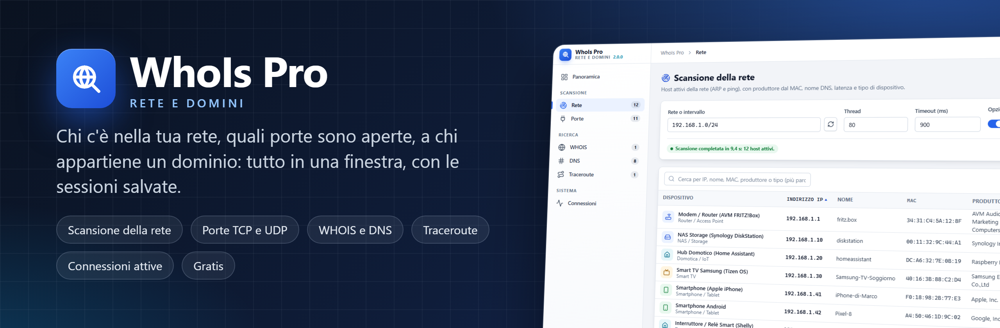
</p>

<p align="center">
  <a href="https://github.com/brn78/WhoIs-Pro/releases/latest"></a>
  
  
  
  
</p>

<p align="center">
  <a href="https://github.com/brn78/WhoIs-Pro/releases/latest"><b>⬇️ Scarica il setup</b></a>
  &nbsp;·&nbsp;
  <a href="#-cosa-fa"><b>✨ Cosa fa</b></a>
  &nbsp;·&nbsp;
  <a href="#-aggiornamenti-al-volo"><b>🔄 Aggiornamenti</b></a>
  &nbsp;·&nbsp;
  <a href="#-domande-frequenti"><b>❓ Domande frequenti</b></a>
</p>

---

**WhoIs Pro** è il programma per Windows che risponde alle domande di chi gestisce una rete, piccola o grande:
*chi c'è nella mia rete?*, *quali porte sono aperte su quel dispositivo?*, *a chi appartiene questo dominio o questo
indirizzo?*, *che strada fanno i pacchetti?*, *quale programma ha aperto questa connessione?* Scansione della rete con
produttore e tipo di dispositivo, porte TCP e UDP con banner, WHOIS, DNS, traceroute e connessioni attive, tutto in
una finestra sola, con le sessioni salvate in un file e i report da esportare.

Gratis, senza account e senza cloud: i dati restano sul tuo PC.

<p align="center">
  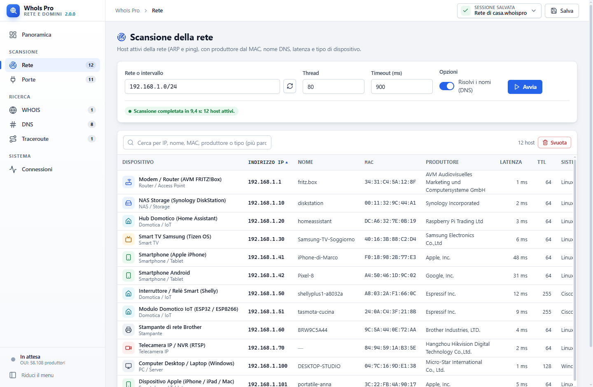
</p>

## ✨ Cosa fa

<table>
<tr>
<td width="50%" valign="top">

**📡 Scansione della rete**<br>
Una rete (`192.168.1.0/24`), un intervallo (`192.168.1.1-50`) o un indirizzo: gli host attivi rispondono ad ARP e
ping e compaiono man mano (un singolo host si **riscansiona** con un clic, anche durante la scansione), con MAC, **produttore** (registri IEEE MA-L, MA-M e MA-S con oltre 58.000 prefissi, il
più preciso per ogni MAC, aggiornabili), nome DNS, latenza, TTL e **tipo di dispositivo** riconosciuto: router, NAS,
Home Assistant, smart TV, telefoni (anche con il MAC privato), telecamere, centrali d'allarme, stampanti, moduli
domotici e automazione. Con **Porte degli host trovati** ogni host passa subito alla scansione delle porte, cinque
alla volta, mentre la rete continua; con **Ripeti** la scansione riparte da sola ogni 1, 5, 15, 30 o 60 minuti.

**🆕 Chi si è collegato**<br>
Ogni dispositivo trovato resta in un registro di questo PC, per MAC: la colonna **Rilevato** dice quando è comparso
la prima volta, anche in una sessione di un mese fa, e chi è nuovo nelle ultime 24 ore. Quando compare un
dispositivo mai visto WhoIs Pro lo segnala, anche con l'avviso di Windows se la finestra è nascosta; chi non
risponde più resta in elenco, segnato *non risponde*.

**🔌 Porte TCP e UDP**<br>
Gruppi di porte pronti (le 20 o le 100 più comuni, web, database, posta, accesso remoto, domotica) o elenco libero
con intervalli; servizio riconosciuto e **banner** letto dal server. Da un host trovato si parte con un clic.

**🌐 WHOIS e DNS**<br>
Registrar, organizzazione, date e name server di un dominio o di un indirizzo, con i referral ai registrar e il
ripiego RDAP; record A, AAAA, PTR, MX, NS e TXT. Le ricerche restano nella sessione.

</td>
<td width="50%" valign="top">

**🛣️ Traceroute**<br>
Il percorso verso una destinazione, salto per salto, con tre tempi per salto e il nome di ogni router; più
destinazioni nella stessa sessione.

**📈 Connessioni attive**<br>
Connessioni TCP e porte in ascolto del PC con il **processo** che le ha aperte, filtri per stato, aggiornamento a
intervalli, scansione o WHOIS dell'indirizzo remoto e chiusura del processo.

**💾 Sessioni e report**<br>
Tutto quello che trovi finisce nella sessione: file `.whoispro` con **salvataggio atomico** (SHA-256 e copia `.bak`),
esportazione in **HTML**, **CSV** per Excel o testo.

**🔀 Profili di rete**<br>
L'indirizzo IP di una scheda salvato con un nome (il sito, il cliente): DHCP oppure IP, maschera, gateway e DNS.
**Applica** lo scrive nella scheda in un clic; Windows chiede il consenso, il programma non ha bisogno di diritti di
amministratore.

**💻 Computer**<br>
Processore, memoria e dischi con i **grafici a ciambella** aggiornati ogni due secondi; Windows, nome del PC,
utente, tempo di accensione, scheda video, schede di rete e **porte seriali (COM)** con il dispositivo collegato.

**📊 Panoramica dal vivo**<br>
Il **traffico** di ogni scheda collegata (ricezione e invio, gli ultimi tre minuti, il LED che lampeggia quando
passano dati), indirizzo, gateway e DNS; gli host trovati con i **nuovi** delle ultime 24 ore, le porte aperte, la
risposta di Internet (anche IPv6), le **ultime scansioni** da ripetere con un clic, processore, memoria e disco; un
campo per **ping e nslookup** al volo.

**🎨 Un'interfaccia da tecnico**<br>
Barra laterale grafite, LED quadrati come quelli delle porte di rete, numeri grandi e leggibili; tabelle ordinabili
con le colonne **larghe quanto il contenuto**, pannelli di dettaglio, menu e notifiche; **tema** automatico, chiaro
o scuro; **Impostazioni** e **Rete del PC** sempre in alto; **icona nell'area di notifica** e avvio con Windows;
scorciatoie da tastiera. Si aggiorna da sola quando esce una versione nuova.

</td>
</tr>
</table>

## 🖼️ Uno sguardo al programma

<table>
<tr>
<td width="50%" align="center">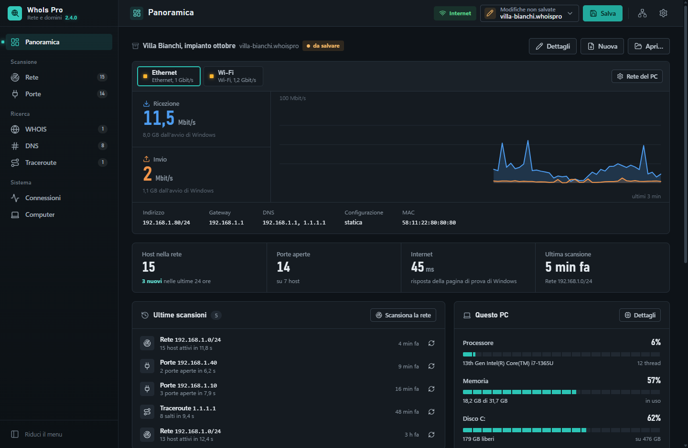<br><b>Panoramica</b>: traffico dal vivo delle schede, rete trovata, ultime scansioni e sistema</td>
<td width="50%" align="center">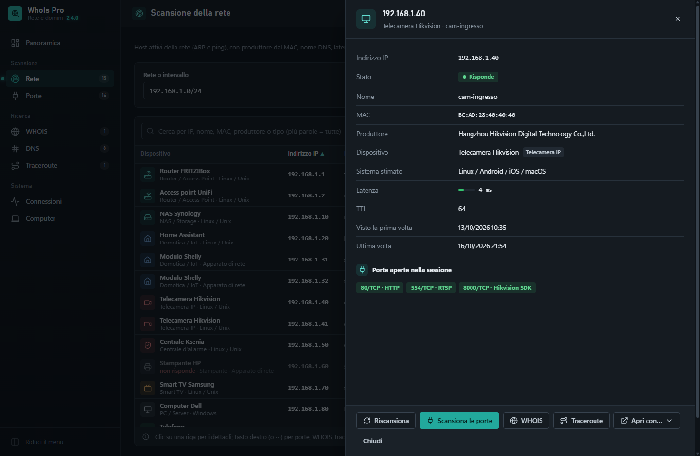<br><b>Dettaglio dell'host</b>: stato, porte, date di rilevamento e «Riscansiona»</td>
</tr>
<tr>
<td align="center">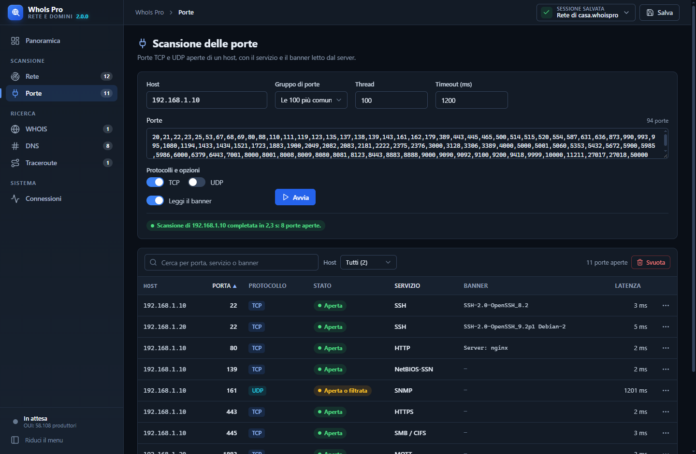<br><b>Porte</b>: TCP e UDP, servizio e banner</td>
<td align="center">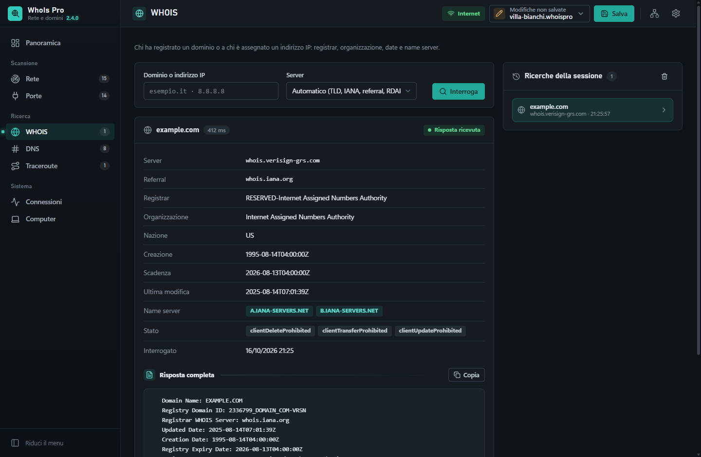<br><b>WHOIS</b>: riepilogo dei campi e risposta completa</td>
</tr>
<tr>
<td align="center">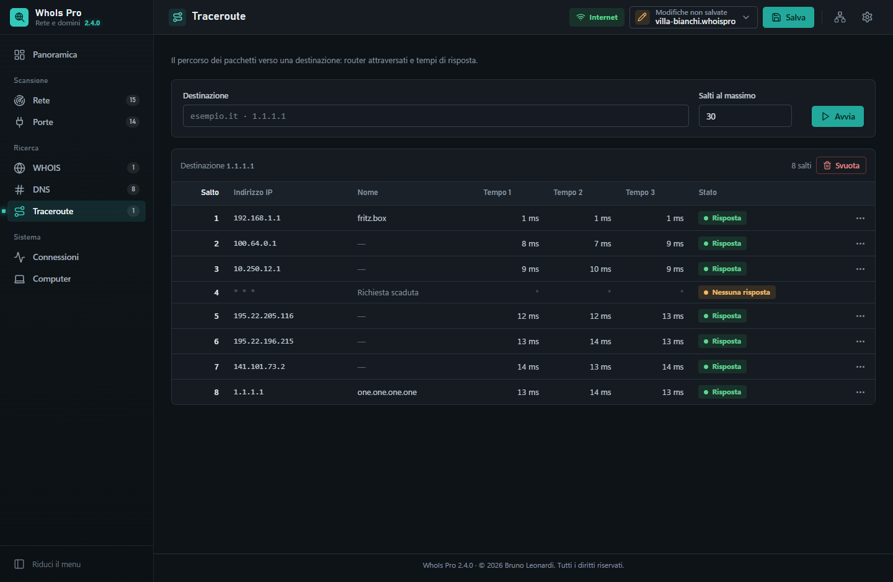<br><b>Traceroute</b>: salti e tempi di risposta</td>
<td align="center">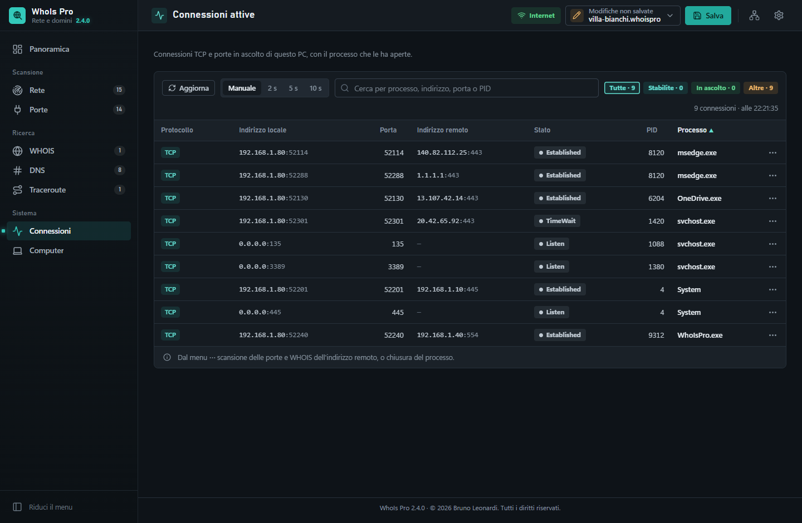<br><b>Connessioni</b>: chi parla con chi, e con quale processo</td>
</tr>
<tr>
<td align="center">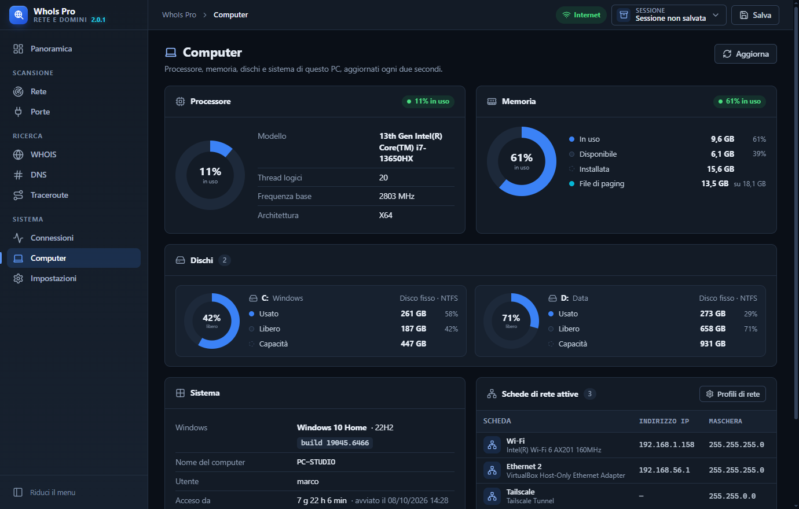<br><b>Computer</b>: processore, memoria e dischi a colpo d'occhio</td>
<td align="center">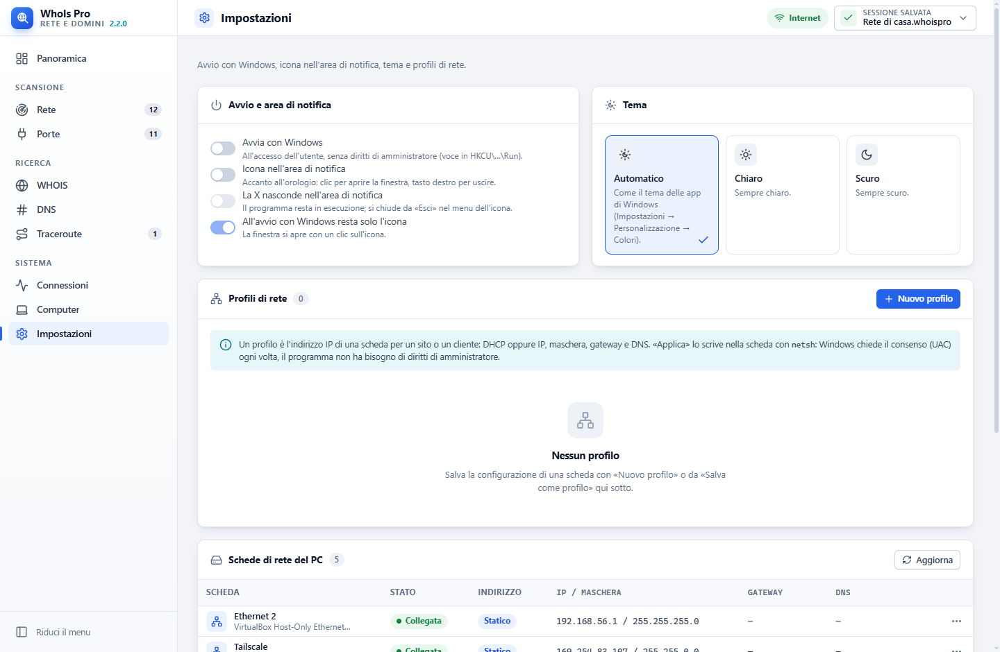<br><b>Impostazioni</b>: rete del PC e profili di rete, avvio, tema, aggiornamenti</td>
</tr>
<tr>
<td align="center">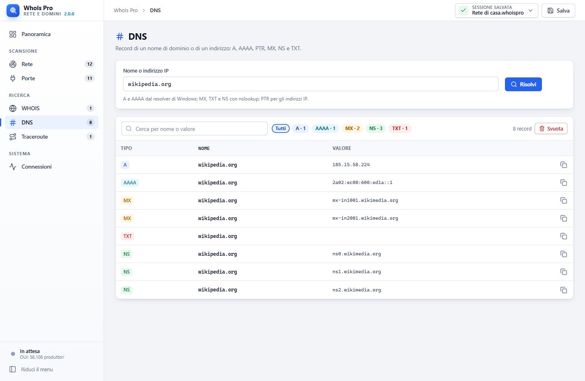<br><b>DNS</b>: record filtrati per tipo</td>
<td align="center">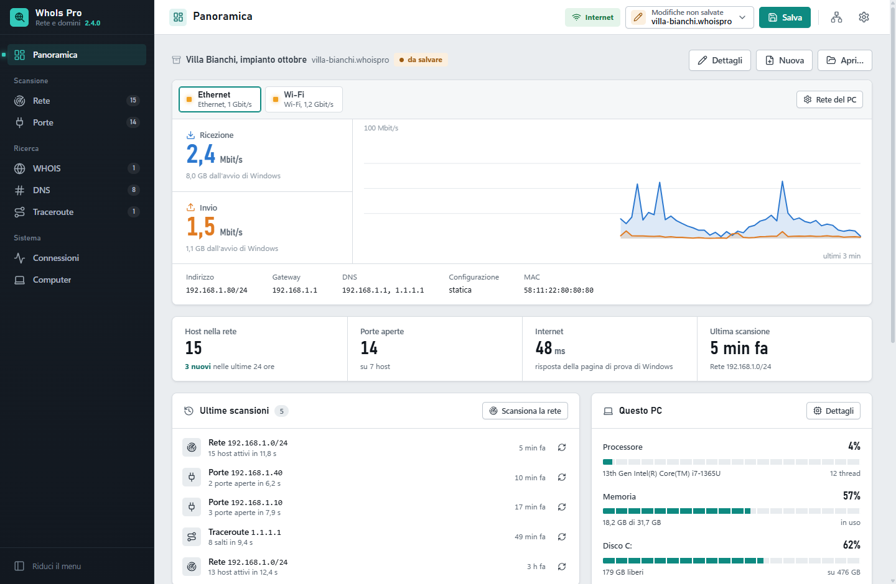<br><b>Tema</b> automatico, chiaro o scuro</td>
</tr>
</table>

## ⬇️ Download e installazione

Dalla pagina [Releases](https://github.com/brn78/WhoIs-Pro/releases/latest):

- **`WhoIsPro-<versione>-Setup.exe`**: il setup. Installa per l'utente corrente, **senza diritti di amministratore**
  (oppure per tutti gli utenti, a scelta), crea il collegamento nel menu Start e si aggiorna da solo.
- **`WhoIsPro-<versione>-win-x64.zip`**: il pacchetto portabile. Si estrae dove si vuole e si avvia `WhoIsPro.exe`.

Entrambi contengono il runtime .NET: non serve installare altro. Serve **Windows 10 (1809) o 11 a 64 bit** con
Microsoft Edge WebView2 Runtime, già presente in Windows.

## 🔄 Aggiornamenti al volo

Il programma installato con il setup controlla **una volta al giorno** (o con *Controlla ora*) qual è l'ultima
versione pubblicata qui su GitHub. Quando ce n'è una nuova lo dice con un avviso e un pallino sull'ingranaggio in
alto; in *Impostazioni → Aggiornamenti* ci sono le novità e il pulsante
**Scarica e installa** fa tutto da solo: scarica il setup dalla release, ne controlla **dimensione, impronta SHA-256 e
versione**, chiude il programma, lo aggiorna e lo riapre. Niente si installa senza il tuo clic e la richiesta a GitHub
non porta nessun dato. Chi usa il pacchetto portabile riceve lo stesso avviso con il collegamento alla pagina dei
download.

## ⌨️ Scorciatoie

| Tasti | Cosa fanno |
| --- | --- |
| <kbd>Ctrl</kbd> + <kbd>N</kbd> · <kbd>Ctrl</kbd> + <kbd>O</kbd> · <kbd>Ctrl</kbd> + <kbd>S</kbd> | Nuova sessione, apri, salva (<kbd>Ctrl</kbd> + <kbd>Maiusc</kbd> + <kbd>S</kbd> salva con nome) |
| <kbd>Invio</kbd> | Avvia la scansione o la ricerca della pagina |
| <kbd>Esc</kbd> | Chiude pannelli, menu e finestre di dialogo |
| Clic sull'intestazione | Ordina la tabella (indirizzi IP e numeri in ordine vero) |

## ❓ Domande frequenti

<details>
<summary><b>Servono i diritti di amministratore?</b></summary>
<br>
No. Il setup installa per l'utente corrente e tutte le funzioni (scansioni, WHOIS, DNS, traceroute, connessioni)
lavorano con un utente normale. <i>Termina il processo</i> chiude solo i processi dell'utente.
</details>

<details>
<summary><b>Perché alcuni host non hanno il MAC o il produttore?</b></summary>
<br>
Il MAC si legge con ARP, che funziona solo nella rete locale: per gli host dietro un router (altre reti, Internet) il
MAC non è disponibile. Telefoni, tablet e PC recenti in Wi-Fi usano un <b>MAC privato</b> (casuale, diverso per ogni
rete): il produttore non si può sapere e la tabella lo dice. Se il produttore manca, aggiorna il database da
<i>Impostazioni → Produttori → Aggiorna dall'IEEE</i>.
</details>

<details>
<summary><b>Quanto è affidabile il tipo di dispositivo?</b></summary>
<br>
È una stima da produttore del MAC, nome DNS, TTL e porte aperte: Home Assistant, Shelly, Samsung, Apple, FRITZ!Box e
così via si riconoscono bene, un PC con una scheda di rete generica resta "Computer". Nel dettaglio dell'host si vede da
cosa deriva.
</details>

<details>
<summary><b>Come cambio l'indirizzo IP della scheda per un sito?</b></summary>
<br>
In <i>Impostazioni → Rete del PC</i> crei un profilo (o lo salvi dalla configurazione attuale della scheda):
nome, scheda, DHCP oppure IP, maschera, gateway e DNS. Poi <b>Applica</b>, anche dal pannello <i>Rete del PC</i>
(l'icona delle schede in alto a destra): Windows chiede il consenso (UAC) perché l'indirizzo lo scrive <code>netsh</code> con i
diritti di amministratore, il programma no. <i>Torna a DHCP</i> rimette la scheda in automatico.
</details>

<details>
<summary><b>Posso lasciarlo sempre aperto?</b></summary>
<br>
Sì: in <i>Impostazioni</i> attivi l'icona nell'area di notifica e, se vuoi, l'avvio con Windows. La X nasconde la
finestra accanto all'orologio; dal menu dell'icona si riapre, si chiude davvero o si applica al volo un
<b>profilo di rete</b> (con la spunta su quello attivo). All'avvio il programma riapre l'ultima sessione salvata.
</details>

<details>
<summary><b>Dove finiscono i dati?</b></summary>
<br>
Le sessioni dove le salvi tu (file <code>.whoispro</code>, in JSON, con le copie <code>.bak</code> accanto). In
<code>%LOCALAPPDATA%\WhoIsPro</code> restano le impostazioni e i profili di rete, il registro dei dispositivi
conosciuti (<code>dispositivi.json</code>, si svuota da <i>Impostazioni → Dati del programma</i>), il database dei produttori
aggiornato, la posizione della finestra e i dati di WebView2. Il programma non contatta nessun server, a parte GitHub per gli aggiornamenti e, a richiesta,
l'IEEE (o Wireshark) per il database dei produttori e i server WHOIS, RDAP e DNS che interroghi.
</details>

<details>
<summary><b>Posso scansionare una rete che non è la mia?</b></summary>
<br>
Scansiona solo reti e dispositivi che gestisci o per cui hai l'autorizzazione: una scansione delle porte su sistemi
altrui può essere vista come un tentativo di intrusione.
</details>

## 🛠️ Per chi vuole compilarlo

Programma in **VB.NET** (.NET 10, Windows Forms) con la finestra fatta da una pagina HTML dentro WebView2, con una
grafica sua: barra laterale grafite, accento verde acqua, LED delle porte e Bahnschrift per titoli e numeri.

```
WhoIs Pro.vbproj        progetto (la cartella ui\ è incorporata nell'exe)
Program.vb              avvio
MainWindow.vb           finestra: WebView2, pagina servita da https://whoispro.invalid, tema, posizione, chiusura
AppBridge.vb            comandi della pagina: scansioni, WHOIS, DNS, traceroute, netstat, sessione, aggiornamenti
Core\Models             HostInfo, PortInfo, WhoisResult, DnsRecordInfo, TracerouteHop, ConnectionInfo, ScanRecord, ScanSession
Core\Network            NetworkScanner, PortScanner, WhoisClient, DnsEngine, TracerouteEngine, NetstatInspector
Core\Storage            AtomicFileManager (salvataggio atomico), SessionExporter (HTML, CSV, testo),
                        DeviceRegistry (dispositivi conosciuti, prima rilevazione)
Core\Utils              NetworkUtils, MacVendorLookup (registri IEEE / manuf di Wireshark), DeviceClassifier, PortDictionary
Core\Update             UpdateService: release su GitHub, scaricamento e verifica del setup
Core\Config             AppSettings: impostazioni (impostazioni.json), avvio automatico, profili di rete
Core\Machine            NetworkConfig (IP delle schede, netsh elevato), ComputerInfo (CPU, memoria, dischi, sistema),
                        TrafficMonitor (traffico delle schede per la Panoramica)
ui\                     index.html, app.css, app.js, core\ (bridge, store, ui, table, chart…), pages\ (una per pagina)
Scripts\                Publish.ps1 (zip portabile), Build-Setup.ps1 (Inno Setup), Publish-Release.ps1 (release su GitHub)
Setup\WhoIsPro.iss      programma di installazione
Tests\                  prove NUnit dei motori in Core\
```

```
dotnet build "WhoIs Pro.vbproj" -c Release
dotnet test Tests\Tests.vbproj
.\Scripts\Build-Setup.ps1        # setup e zip in artifacts\ (serve Inno Setup)
.\dev\serve.ps1                  # anteprima dell'interfaccia nel browser, con dati finti (http://localhost:5517/)
```

La cartella `dev\` non finisce nel programma: `preview.html` carica la pagina vera di `ui\` con `mock.js`, che risponde
ai comandi al posto del programma con una rete dimostrativa. Serve per lavorare sulla grafica senza compilare.

La pagina chiede le operazioni al programma con `postMessage({ id, cmd, args })` e riceve `{ id, ok, result | error }`;
le scansioni in corso mandano eventi (`network.progress`, `ports.progress`, `trace.hop`, `…done`) accorpati ogni
120 ms. Con `WHOISPRO_DEVTOOLS=1` (o nella versione Debug) si apre DevTools con F12. Le novità di ogni versione sono nel
[CHANGELOG](CHANGELOG.md); i componenti e i dati di terze parti, con le loro licenze, in
[THIRD-PARTY-NOTICES.md](THIRD-PARTY-NOTICES.md), che il setup copia accanto al programma.

## 📬 Contatti

Segnalazioni e idee nelle [Issues](https://github.com/brn78/WhoIs-Pro/issues), oppure **b.leonardi78@gmail.com**.

---

<p align="center">
  <sub>© 2026 Bruno Leonardi · Tutti i diritti riservati.<br>
  Le immagini mostrano una rete dimostrativa.</sub>
</p>
